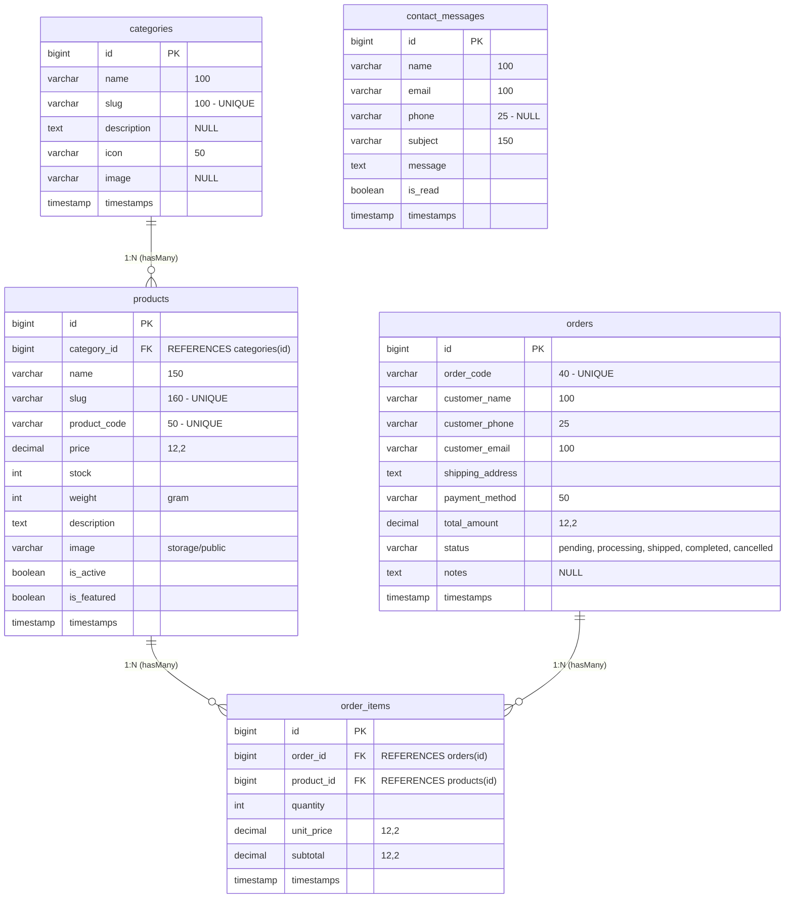

# IZZARA Oleh-Oleh — Platform Web Dinamis UMKM (Laravel)

Platform website dinamis berbasis **Laravel** dan **Bootstrap 5** untuk UMKM **IZZARA Oleh-Oleh** di bawah naungan **PT Istana Oleh-Oleh Indonesia**. Website ini dikembangkan untuk memenuhi ketentuan tugas/UTS Pemrograman Web 2 secara lengkap, elegan, dan siap digunakan.

---

## 📌 Identitas Bisnis & Brand

| Atribut | Keterangan |
| :--- | :--- |
| **Nama PT (Konsep)** | PT Istana Oleh-Oleh Indonesia *(Inisial 'I')* |
| **Nama UMKM / Brand** | IZZARA Oleh-Oleh *(Pusat Oleh-Oleh Nusantara)* |
| **Bidang Usaha** | Penjualan aneka produk oleh-oleh khas daerah Nusantara |
| **Tagline** | *"Bawa Pulang Kenangan Terbaik."* |
| **Warna Utama** | Cokelat Keemasan (`#5A2C18`), Krem Hangat (`#FAF4EB`), Emas Elegan (`#D4AF37`) |
| **Logo** | Inisial huruf "I" berpadu dengan tas belanja keemasan (golden shopping bag) |
| **Framework & DB** | Laravel 9 (PHP 8.0+), MySQL / MariaDB, Bootstrap 5.3 + Bootstrap Icons |

---

## 🚀 Panduan Menjalankan Project

### 1. Menjalankan Server Database MySQL
Pastikan server MySQL berjalan (misalnya melalui XAMPP Control Panel atau baris perintah):
```bash
# Buka XAMPP Control Panel dan start MySQL, atau jalankan melalui console:
C:\xampp\mysql\bin\mysqld.exe --defaults-file=C:\xampp\mysql\bin\my.ini --standalone
```

### 2. Konfigurasi Environment & Storage
Pengaturan `.env` sudah terpasang ke database `izzara_db`:
```ini
DB_CONNECTION=mysql
DB_HOST=127.0.0.1
DB_PORT=3306
DB_DATABASE=izzara_db
DB_USERNAME=root
DB_PASSWORD=
```
Simbolik link storage sudah dibuat dengan perintah:
```bash
php artisan storage:link
```

### 3. Migrasi & Seeding Data (Opsional jika ingin reset)
```bash
php artisan migrate:fresh --seed
```

### 4. Menjalankan Website (Artisan Serve)
Jalankan perintah berikut di root folder project:
```bash
php artisan serve
```
Buka browser dan akses alamat:
- **Halaman Publik:** `http://127.0.0.1:8000`
- **Panel Administrator:** `http://127.0.0.1:8000/admin/login`

---

## 🔐 Sistem Autentikasi Ganda: Web Customer & Admin Panel

Sistem ini membedakan peran antara **Pelanggan (Customer)** dan **Administrator (Admin)**:

| Peran | URL Halaman | Kredensial Demo | Hak Akses & Fitur |
| :--- | :--- | :--- | :--- |
| **Pelanggan (Web Customer)** | `http://127.0.0.1:8000/login`<br>Daftar: `/register` | **Email:** `customer@izzara.com`<br>**Password:** `customer123` | • Registrasi akun baru & login pelanggan<br>• Dashboard akun pelanggan (`/customer/dashboard`)<br>• Riwayat semua pesanan & status tracking (`/customer/orders`)<br>• Lihat rincian & nota pesanan per transaksi<br>• Pengaturan profil, nomor telepon, dan alamat pengiriman<br>• Checkout otomatis terisi dari data profil akun |
| **Administrator (Admin)** | `http://127.0.0.1:8000/admin/login` | **Email:** `admin@izzara.com`<br>**Password:** `admin123` | • Dilindungi middleware `auth` dan `admin`<br>• Dashboard statistik bisnis (pendapatan, omset, stok)<br>• CRUD Produk (tambah, ubah, hapus, upload foto ke storage/public)<br>• CRUD Kategori produk<br>• Kelola pesanan pelanggan & ubah status pesanan<br>• Inbox pesan formulir kontak publik |

> **Catatan Keamanan:** Jika akun pelanggan mencoba mengakses URL `/admin/*`, middleware `AdminMiddleware` secara otomatis akan memblokir akses dan mengalihkan ke halaman utama dengan pesan penolakan hak akses.

---

## ✅ Pemenuhan 8 Ketentuan Wajib

| No | Ketentuan Wajib | Status | Bukti Implementasi |
| :---: | :--- | :---: | :--- |
| **1** | **Project Laravel baru yang berjalan tanpa error** | ✅ **Selesai** | `php artisan serve` berjalan normal di port 8000 tanpa error. |
| **2** | **Database + migration minimal 2 tabel berelasi** | ✅ **Selesai** | Memiliki **5 tabel berelasi**: `categories`, `products` (FK ke `categories`), `orders`, `order_items` (FK ke `orders` & `products`), dan `contact_messages`. |
| **3** | **Model + relasi Eloquent** | ✅ **Selesai** | Model `Category` (`hasMany` Product), `Product` (`belongsTo` Category, `hasMany` OrderItem), `Order` (`hasMany` OrderItem), dan `OrderItem` (`belongsTo` Order, `belongsTo` Product). |
| **4** | **Halaman Dinamis Publik & Admin** | ✅ **Selesai** | **Publik**: Beranda, Katalog Produk (filter & search), Detail Produk per item, Kategori, Tentang Kami, Kontak, Form Pesan Online.<br>**Admin**: Dashboard Statistik, CRUD Produk, CRUD Kategori, Kelola Pesanan (Ubah Status), Inbox Pesan Kontak. |
| **5** | **Upload Foto Produk disimpan di storage/public** | ✅ **Selesai** | Menggunakan `$request->file('image')->store('products', 'public')`. Gambar disimpan di `storage/app/public/products` dan dapat diakses publik melalui `asset('storage/...')`. |
| **6** | **Validasi Form Server-side minimal 3 aturan** | ✅ **Selesai** | Diterapkan di semua Controller: `required` (wajib diisi), `max:150` (maksimal karakter), `numeric`/`integer`/`image`/`email` (tipe data), `mimes:jpeg,png,jpg,webp`, dan `min:0`. Dilengkapi pesan error berbahasa Indonesia yang jelas. |
| **7** | **Tampilan Responsif** | ✅ **Selesai** | Dibangun dengan **Bootstrap 5.3**, mobile-friendly, navbar responsif, grid card responsif, dan modal/form responsif. |
| **8** | **Seeder minimal 5 data contoh** | ✅ **Selesai** | `DatabaseSeeder.php` berisi **4 Kategori**, **9 Produk lengkap dengan gambar asli**, **3 Pesanan & Rincian Transaksi**, **2 Pesan Kontak Masuk**, dan **1 Admin User**. |

---

## 🗄️ Struktur Relasi Database (ERD)



---

## 📋 Daftar Formulir Sesuai Spesifikasi

### A. Form Admin
1. **Login Admin** (`/admin/login`) — Autentikasi dengan proteksi middleware `auth` dan proteksi sesi.
2. **Tambah Produk** (`/admin/products/create`) — Input 10 atribut produk, upload foto dengan preview instan.
3. **Edit Produk** (`/admin/products/{id}/edit`) — Ubah data produk dan preview pergantian foto.
4. **Tambah Kategori** (`/admin/categories/create`) — Membuat kategori baru beserta icon Bootstrap.
5. **Edit Kategori** (`/admin/categories/{id}/edit`) — Mengubah nama dan deskripsi kategori.
6. **Tambah Pesanan Manual** (`/admin/orders/create`) — Menginput pesanan pelanggan langsung dari kasir/admin.
7. **Edit Status Pesanan** (`/admin/orders/{id}`) — Mengubah status pesanan (`Menunggu Konfirmasi`, `Diproses`, `Dikirim`, `Selesai`, `Dibatalkan`) serta opsi langsung menghubungi pembeli melalui WhatsApp.

### B. Form Tambah & Edit Produk (10 Field Lengkap)
1. `Nama produk` (Text)
2. `Kode produk` (Text, unik)
3. `Kategori` (Dropdown dari database)
4. `Harga` (Number)
5. `Stok` (Number)
6. `Berat produk` (Number, satuan gram)
7. `Deskripsi` (Textarea)
8. `Foto produk` (Upload file gambar ke `storage/public`)
9. `Status produk` (Radio: Aktif / Tidak Aktif)
10. `Produk unggulan` (Radio: Ya / Tidak)

### C. Form Pemesanan Pelanggan (`/pesan`)
1. `Nama lengkap` (Text)
2. `Nomor WhatsApp` (Telephone)
3. `Email` (Email)
4. `Alamat pengiriman` (Textarea)
5. `Pilih produk` (Dropdown)
6. `Jumlah pembelian` (Number)
7. `Metode pembayaran` (Dropdown: Transfer BCA, Mandiri, BRI, QRIS, COD)
8. `Catatan pesanan` (Textarea)
*Dilengkapi kalkulasi total belanja otomatis (JavaScript), invoice pemesanan, dan tombol langsung konfirmasi WhatsApp ke admin.*

### D. Form Kontak (`/kontak`)
1. `Nama lengkap` (Text)
2. `Email` (Email)
3. `Nomor WhatsApp` (Telephone)
4. `Subjek` (Text)
5. `Isi pesan` (Textarea)
*Pesan yang dikirim otomatis masuk ke database dan dapat dibaca admin pada menu Pesan Masuk.*

---

## 📦 4 Kategori & 9 Contoh Produk Seeder

1. **Makanan Ringan**
   - Keripik Pisang Lumrah — `Rp15.000` (Unggulan)
   - Sale Pisang Crispy — `Rp18.000` (Unggulan)
   - Keripik Singkong Balado — `Rp16.000`
2. **Kue Tradisional**
   - Kue Lapis Legit Spesial — `Rp25.000` (Unggulan)
   - Dodol Tradisional Asli — `Rp22.000`
3. **Makanan dan Minuman**
   - Kopi Bubuk Lokal Robusta — `Rp30.000` (Unggulan)
   - Sambal Khas Daerah — `Rp20.000` (Unggulan)
4. **Souvenir Daerah**
   - Dompet Batik Etnik — `Rp35.000`
   - Gantungan Kunci Kayu Ukir — `Rp12.000`

---

## 🎨 Visi, Misi & Tagline UMKM

### Visi
> *"Menjadi pusat oleh-oleh lokal yang terpercaya, berkualitas, dan dikenal oleh masyarakat luas."*

### Misi
1. Menyediakan berbagai pilihan oleh-oleh khas daerah.
2. Menjaga kualitas dan kebersihan setiap produk.
3. Mendukung perkembangan UMKM dan produk lokal.
4. Memberikan pelayanan terbaik kepada pelanggan.
5. Memanfaatkan teknologi digital untuk memperluas pemasaran.

### Tagline
> **"Bawa Pulang Kenangan Terbaik."**

---
*Dikembangkan dengan dedikasi penuh untuk tugas UTS Pemrograman Web 2.*
